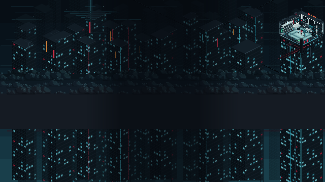
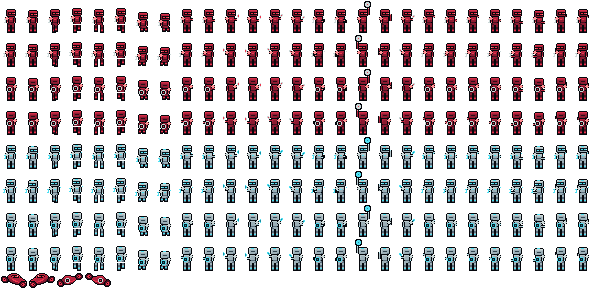

<p align="center">
  
</p>

<h1 align="center">Red Code</h1>

<p align="center">
  <b>A pixel-art city at night as your Claude Code interface.</b><br>
  A tall tower with its top floor cut away to show one room, where Red Code, a small crimson program, acts out what your session is doing.<br>
  The towers are smooth black with light let into them: no windows, only channels of cyan-white light. The tower's spine turns crimson while Claude works.
</p>

<p align="center">
  <code>v0.9.0</code> · Claude Code desktop app (Windows) · dark mode
</p>

---

## The art

| Launch | Helpers at work | Needs you |
| :---: | :---: | :---: |
|  |  |  |
| Your prompt is accepted | Agents are running | A permission request or question |

<sub>Previews drawn from hand-made states, not screenshots of the app.</sub>

**Sprite atlas** (`red-code/art/atlas.png`, one pixel to a pixel, cells named in `atlas.json`):

<p align="center">
  
</p>

## Install

```
claude plugin marketplace add lejoey50-coder/red-code
claude plugin install red-code@red-code-mods
```

Start a new session. Red Code starts by itself in every new chat.

## Controls

| Type | What it does |
| --- | --- |
| `/redcode` | The building as your interface |
| `/redcode strip` | The app's own look, with a small strip above the message box |
| `/redcode off` | Off in every chat, until `/redcode` |
| `/redcode motion still` / `full` | Stops or restores movement |
| `/redcode size 1600x900` | Tells Red Code your window size, if clicks land a tile off |

Click the room's floor, chair, window or hologram and he walks over and uses it.

## What it reads, stores and sends

It reads event types, tool names and the last part of a file name. It stores its settings on this PC. It sends nothing anywhere, and it cannot block or change a prompt or a tool call.

## More

Full details (every event, signal and control): [`red-code/README.md`](red-code/README.md)

## Layout

```
.claude-plugin/marketplace.json   marketplace "red-code-mods"
red-code/
  .claude-plugin/plugin.json      plugin manifest
  hooks/                          the mod (register.tsx is the entry point)
  art/                            sprite atlas, previews, make.mjs
  tests/                          red-code.test.tsx
  types/                          type definitions
```
